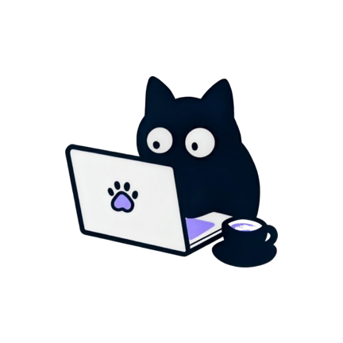
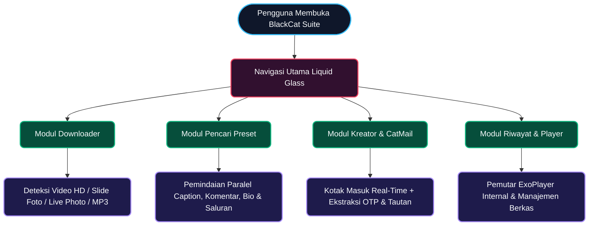
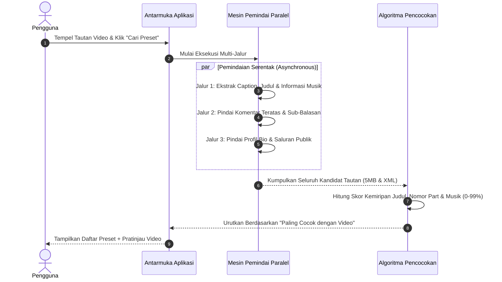

<!-- ========================================================================================= -->
<!--                                    HERO HEADER BANNER                                     -->
<!-- ========================================================================================= -->

<!-- OFFICIAL BLACKCAT MASCOT LOGO -->

  

<!-- ANIMATED TYPING SUBTITLE -->

  

<!-- TECH & STATUS BADGES (VECTOR LOGOS) -->

  
  
  
  
  

<!-- NAVIGATION BUTTONS -->

  
  
  
  
  
  

---

## Ringkasan Ekosistem

> *"Kecepatan tanpa mengorbankan estetika; menghadirkan pengalaman kreatif serba otomatis dalam satu sentuhan."*

> [!IMPORTANT]
> **BlackCat Suite** adalah aplikasi utilitas media modern untuk Android yang menggabungkan **Pengunduh Konten TikTok Tanpa Watermark** (Video HD, Album Slide Foto, *Live Photo*, dan Audio MP3), **Mesin Pencari Preset Alight Motion Paralel**, serta **CatMail (Kotak Masuk Instan dengan Pemindai OTP Pintar)** di dalam satu antarmuka **Material Design 3 Expressive & Liquid Glass**.

---

## Empat Pilar Utama

<table>
  <tr>
    <td width="50%" valign="top">
      

        
        &nbsp;<b>Multi-Format Media Downloader</b>
      

      
Mengunduh video TikTok kualitas HD tanpa watermark, mengekstrak audio MP3 murni, menyimpan album slide foto secara massal (<i>batch</i>), serta mendukung format <b>Live Photo (Motion Video)</b> secara otomatis.

    </td>
    <td width="50%" valign="top">
      

        
        &nbsp;<b>Turbo Preset Finder</b>
      

      
Memindai deskripsi video, komentar teratas, balasan kreator, tautan bio, hingga saluran komunitas secara paralel untuk menemukan preset Alight Motion (<b>5MB</b> & <b>XML</b>) paling akurat dalam hitungan detik.

    </td>
  </tr>
  <tr>
    <td width="50%" valign="top">
      

        
        &nbsp;<b>CatMail & Smart OTP Extractor</b>
      

      
Menyediakan kotak masuk email instan multi-domain dengan pemindai reguler cerdas yang memisahkan kode OTP 6-digit asli dari angka tanggal/tahun serta mengekstrak tautan verifikasi secara otomatis.

    </td>
    <td width="50%" valign="top">
      

        
        &nbsp;<b>Liquid Glass UI & Media Player</b>
      

      
Dilengkapi navigasi mengambang berbasis <i>Liquid Glass</i>, pemutar video & audio internal (<b>Media3 ExoPlayer</b>), riwayat unduhan terorganisir, serta pembaruan aplikasi otomatis (<i>In-App Update</i>).

    </td>
  </tr>
</table>

---

## Arsitektur & Cara Kerja Aplikasi

BlackCat memproses seluruh permintaan pengguna melalui alur kerja paralel yang terstruktur sehingga waktu tunggu menjadi sangat singkat dan responsif.

### 1. Alur Sistem Terpadu (Flowchart Interaktif)

> [!TIP]
> Gunakan kontrol *zoom* dan *pan* di sudut kanan atas diagram GitHub untuk memperbesar bagian bagan.

### 2. Urutan Eksekusi Pencari Preset Paralel)

---

## Spesifikasi Modul Interaktif

Klik pada masing-masing baris di bawah ini untuk membuka rincian setiap fitur:

<b>01 — Multi-Format TikTok Downloader (Video HD, Slide Foto, Live Photo)</b>

 

| Kapabilitas | Penjelasan Fitur |
| :--- | :--- |
| **Deteksi Tipe Otomatis** | Mengenali secara instan apakah tautan berupa **Video**, **Album Slide Foto**, atau **Live Photo (Foto Bergerak)** tanpa perlu memilih mode manual. |
| **Kualitas Video Tanpa Watermark** | Menyediakan opsi unduhan **HD No-Watermark**, **Standard No-Watermark**, **Watermark**, serta ekstraksi **Audio MP3**. |
| **Manajemen Slide & Batch Save** | Memungkinkan pemilihan foto tertentu di dalam album *carousel* atau mengunduh seluruh slide sekaligus dalam satu ketukan. |
| **In-App Media Player** | Dilengkapi pemutar video dan audio bawaan berbasis **AndroidX Media3 ExoPlayer** untuk mempratinjau hasil sebelum disimpan. |

<b>02 — Turbo Preset Finder Alight Motion (Parallel Deep Scanner)</b>

 

| Kapabilitas | Penjelasan Fitur |
| :--- | :--- |
| **Pemindaian Multi-Sumber** | Memeriksa deskripsi video, komentar yang disematkan (*pinned*), balasan kreator, komentar penonton, hingga halaman tautan di bio. |
| **Deteksi Tautan Komunitas** | Mengenali tautan saluran WhatsApp, Telegram, serta halaman *bio link hub* dan mengekstrak preset di dalamnya secara otomatis. |
| **Smart Match Scoring** | Memberikan persentase kecocokan (`0% – 99%`) berdasarkan kesamaan kata kunci judul, nomor bagian (*Part / #*), dan judul musik video. |
| **Dukungan Format Lengkap** | Mendeteksi tautan **Preset 5MB** maupun berkas **XML** dari berbagai penyedia penyimpanan awan populer. |

<b>03 — CatMail Multi-Domain & Smart OTP Extractor</b>

 

| Kapabilitas | Penjelasan Fitur |
| :--- | :--- |
| **Pembuatan Email Instan** | Membuat alamat email sementara secara instan dengan dukungan pergantian domain aktif kapan saja. |
| **Filter OTP Kontekstual** | Menyaring angka tahun, tanggal, waktu, dan resolusi di dalam badan email sehingga hanya menyalin **Kode Verifikasi OTP 6-Digit** yang valid. |
| **Deteksi Tautan Aktivasi** | Menemukan tautan login atau verifikasi di dalam pesan HTML dan menampilkannya sebagai tombol aksi cepat. |

<b>04 — Antarmuka Liquid Glass & Sistem Pembaruan Otomatis (Auto-Update)</b>

 

| Kapabilitas | Penjelasan Fitur |
| :--- | :--- |
| **Floating Liquid Glass Navigation** | Bilah navigasi mengambang modern dengan animasi pegas (*spring physics*) yang responsif dan adaptif pada berbagai ukuran layar. |
| **In-App Auto Update** | Memeriksa ketersediaan versi baru secara berkala, menampilkan catatan perubahan (*changelog*), dan mengunduh pembaruan langsung di dalam aplikasi. |

---

## Perbandingan Kapabilitas

| Fitur & Pengalaman Pengguna | TIKTOK | BlackCat Suite |
| :--- | :---: | :---: |
| **Unduh Video HD Tanpa Watermark** |  |  |
| **Unduh Album Slide Foto & Live Photo** |  |  |
| **Pencari Preset Alight Motion (5MB & XML)** |  |  |
| **Deteksi Saluran & Skor Kecocokan Preset** |  |  |
| **CatMail Instan & Auto-Extract Kode OTP** |  |  |
| **Antarmuka Material 3 & Liquid Glass** |  |  |
| **Pembaruan Aplikasi (*In-App Auto Update*)** |  |  |

---

## Teknologi & Komponen Utama

| Lapisan Sistem | Teknologi yang Digunakan |
| :--- | :--- |
| **Bahasa & Concurrency** |  &nbsp;`Coroutines` • `StateFlow` • `Parallel Async Execution` |
| **Antarmuka Pengguna** |  &nbsp;`Material Design 3 Expressive` • `Liquid Glass Navigation` • `Coil` |
| **Pemutar Media** |  &nbsp;`ExoPlayer Video & Audio Streaming` |
| **Jaringan & Mesin Pencari** |  &nbsp;`High-Speed Connection Pool` • `Smart Regex Parser` |

---

## Panduan Penggunaan Cepat

> [!NOTE]
> Gunakan selalu versi terbaru **BlackCat Suite** dari halaman [**Releases**](../../releases) untuk menikmati seluruh fitur secara penuh beserta pembaruan otomatis.

1. **Mengunduh Video, Slide Foto, atau Live Photo**:
   Salin tautan postingan dari TikTok, buka **BlackCat**, tempelkan tautan pada kolom utama, lalu pilih kualitas unduhan (**HD No-Watermark**, **Slide Foto**, **Live Photo**, atau **MP3**).
2. **Mencari Preset Alight Motion**:
   Buka tab **Preset**, tempelkan tautan video TikTok, lalu tekan **Cari Preset**, daftar preset **5MB** maupun **XML** beserta tombol pintas saluran kreator akan langsung ditampilkan.
3. **Menggunakan CatMail & Salin OTP Otomatis**:
   Buka tab **Alight Motion / CatMail**, buat email instan dengan satu ketukan, dan gunakan tombol salin cepat begitu kode verifikasi OTP 6-digit atau tautan masuk ke kotak pesan.

---

<!-- ========================================================================================= -->
<!--                                     ANIMATED FOOTER                                       -->
<!-- ========================================================================================= -->

or</b>

 

| Kapabilitas | Penjelasan Fitur |
| :--- | :--- |
| **Pembuatan Email Instan** | Membuat alamat email sementara secara instan dengan dukungan pergantian domain aktif kapan saja. |
| **Filter OTP Kontekstual** | Menyaring angka tahun, tanggal, waktu, dan resolusi di dalam badan email sehingga hanya menyalin **Kode Verifikasi OTP 6-Digit** yang valid. |
| **Deteksi Tautan Aktivasi** | Menemukan tautan login atau verifikasi di dalam pesan HTML dan menampilkannya sebagai tombol aksi cepat. |

<b>04 — Antarmuka Liquid Glass & Sistem Pembaruan Otomatis (Auto-Update)</b>

 

| Kapabilitas | Penjelasan Fitur |
| :--- | :--- |
| **Floating Liquid Glass Navigation** | Bilah navigasi mengambang modern dengan animasi pegas (*spring physics*) yang responsif dan adaptif pada berbagai ukuran layar. |
| **In-App Auto Update** | Memeriksa ketersediaan versi baru secara berkala, menampilkan catatan perubahan (*changelog*), dan mengunduh pembaruan langsung di dalam aplikasi. |

---

## Perbandingan Kapabilitas

| Fitur & Pengalaman Pengguna | Downloader Standar | BlackCat Suite |
| :--- | :---: | :---: |
| **Unduh Video HD Tanpa Watermark** |  |  |
| **Unduh Album Slide Foto & Live Photo** |  |  |
| **Pencari Preset Alight Motion (5MB & XML)** |  |  |
| **Deteksi Saluran & Skor Kecocokan Preset** |  |  |
| **CatMail Instan & Auto-Extract Kode OTP** |  |  |
| **Antarmuka Material 3 & Liquid Glass** |  |  |
| **Pembaruan Aplikasi (*In-App Auto Update*)** |  |  |

---

## Teknologi & Komponen Utama

| Lapisan Sistem | Teknologi yang Digunakan |
| :--- | :--- |
| **Bahasa & Concurrency** |  &nbsp;`Coroutines` • `StateFlow` • `Parallel Async Execution` |
| **Antarmuka Pengguna** |  &nbsp;`Material Design 3 Expressive` • `Liquid Glass Navigation` • `Coil` |
| **Pemutar Media** |  &nbsp;`ExoPlayer Video & Audio Streaming` |
| **Jaringan & Mesin Pencari** |  &nbsp;`High-Speed Connection Pool` • `Smart Regex Parser` |

---

## Panduan Penggunaan Cepat

> [!NOTE]
> Gunakan selalu versi terbaru **BlackCat Suite** dari halaman [**Releases**](../../releases) untuk menikmati seluruh fitur secara penuh beserta pembaruan otomatis.

1. **Mengunduh Video, Slide Foto, atau Live Photo**:
   Salin tautan postingan dari TikTok, buka **BlackCat**, tempelkan tautan pada kolom utama, lalu pilih kualitas unduhan (**HD No-Watermark**, **Slide Foto**, **Live Photo**, atau **MP3**).
2. **Mencari Preset Alight Motion**:
   Buka tab **Preset**, tempelkan tautan video TikTok, lalu tekan **Cari Preset**, daftar preset **5MB** maupun **XML** beserta tombol pintas saluran kreator akan langsung ditampilkan.
3. **Menggunakan CatMail & Salin OTP Otomatis**:
   Buka tab **Alight Motion / CatMail**, buat email instan dengan satu ketukan, dan gunakan tombol salin cepat begitu kode verifikasi OTP 6-digit atau tautan masuk ke kotak pesan.

---

<!-- ========================================================================================= -->
<!--                                     ANIMATED FOOTER                                       -->
<!-- ========================================================================================= -->

ummary><b>03 — TapMail Multi-Domain & Smart OTP Extractor</b>

 

| Kapabilitas | Penjelasan Fitur |
| :--- | :--- |
| **Pembuatan Email Instan** | Membuat alamat email sementara secara instan dengan dukungan pergantian domain aktif kapan saja. |
| **Filter OTP Kontekstual** | Menyaring angka tahun, tanggal, waktu, dan resolusi di dalam badan email sehingga hanya menyalin **Kode Verifikasi OTP 6-Digit** yang valid. |
| **Deteksi Tautan Aktivasi** | Menemukan tautan login atau verifikasi di dalam pesan HTML dan menampilkannya sebagai tombol aksi cepat. |

<b>04 — Antarmuka Liquid Glass & Sistem Pembaruan Otomatis (Auto-Update)</b>

 

| Kapabilitas | Penjelasan Fitur |
| :--- | :--- |
| **Floating Liquid Glass Navigation** | Bilah navigasi mengambang modern dengan animasi pegas (*spring physics*) yang responsif dan adaptif pada berbagai ukuran layar. |
| **In-App Auto Update** | Memeriksa ketersediaan versi baru secara berkala, menampilkan catatan perubahan (*changelog*), dan mengunduh pembaruan langsung di dalam aplikasi. |

---

## Perbandingan Kapabilitas

| Fitur & Pengalaman Pengguna | Downloader Standar | BlackCat Suite |
| :--- | :---: | :---: |
| **Unduh Video HD Tanpa Watermark** |  |  |
| **Unduh Album Slide Foto & Live Photo** |  |  |
| **Pencari Preset Alight Motion (5MB & XML)** |  |  |
| **Deteksi Saluran & Skor Kecocokan Preset** |  |  |
| **TapMail Instan & Auto-Extract Kode OTP** |  |  |
| **Antarmuka Material 3 & Liquid Glass** |  |  |
| **Pembaruan Aplikasi (*In-App Auto Update*)** |  |  |

---

## Teknologi & Komponen Utama

| Lapisan Sistem | Teknologi yang Digunakan |
| :--- | :--- |
| **Bahasa & Concurrency** |  &nbsp;`Coroutines` • `StateFlow` • `Parallel Async Execution` |
| **Antarmuka Pengguna** |  &nbsp;`Material Design 3 Expressive` • `Liquid Glass Navigation` • `Coil` |
| **Pemutar Media** |  &nbsp;`ExoPlayer Video & Audio Streaming` |
| **Jaringan & Mesin Pencari** |  &nbsp;`High-Speed Connection Pool` • `Smart Regex Parser` |

---

## Panduan Penggunaan Cepat

> [!NOTE]
> Gunakan selalu versi terbaru **BlackCat Suite** dari halaman [**Releases**](../../releases) untuk menikmati seluruh fitur secara penuh beserta pembaruan otomatis.

1. **Mengunduh Video, Slide Foto, atau Live Photo**:
   Salin tautan postingan dari TikTok, buka **BlackCat**, tempelkan tautan pada kolom utama, lalu pilih kualitas unduhan (**HD No-Watermark**, **Slide Foto**, **Live Photo**, atau **MP3**).
2. **Mencari Preset Alight Motion**:
   Buka tab **Preset**, tempelkan tautan video TikTok, lalu tekan **Cari Preset**. Dalam **2–5 detik**, daftar preset **5MB** maupun **XML** beserta tombol pintas saluran kreator akan langsung ditampilkan.
3. **Menggunakan TapMail & Salin OTP Otomatis**:
   Buka tab **Alight Motion / TapMail**, buat email instan dengan satu ketukan, dan gunakan tombol salin cepat begitu kode verifikasi OTP 6-digit atau tautan masuk ke kotak pesan.

---

<!-- ========================================================================================= -->
<!--                                     ANIMATED FOOTER                                       -->
<!-- ========================================================================================= -->

buat alamat email sementara secara instan dengan dukungan pergantian domain aktif kapan saja. |
| **Filter OTP Kontekstual** | Menyaring angka tahun, tanggal, waktu, dan resolusi di dalam badan email sehingga hanya menyalin **Kode Verifikasi OTP 6-Digit** yang valid. |
| **Deteksi Tautan Aktivasi** | Menemukan tautan login atau verifikasi di dalam pesan HTML dan menampilkannya sebagai tombol aksi cepat. |

<b>04 — Antarmuka Liquid Glass & Sistem Pembaruan Otomatis (Auto-Update)</b>

 

| Kapabilitas | Penjelasan Fitur |
| :--- | :--- |
| **Floating Liquid Glass Navigation** | Bilah navigasi mengambang modern dengan animasi pegas (*spring physics*) yang responsif dan adaptif pada berbagai ukuran layar. |
| **In-App Auto Update** | Memeriksa ketersediaan versi baru secara berkala, menampilkan catatan perubahan (*changelog*), dan mengunduh pembaruan langsung di dalam aplikasi. |

---

## Perbandingan Kapabilitas

| Fitur & Pengalaman Pengguna | Downloader Standar | BlackCat Suite |
| :--- | :---: | :---: |
| **Unduh Video HD Tanpa Watermark** |  |  |
| **Unduh Album Slide Foto & Live Photo** |  |  |
| **Pencari Preset Alight Motion (5MB & XML)** |  |  |
| **Deteksi Saluran & Skor Kecocokan Preset** |  |  |
| **TapMail Instan & Auto-Extract Kode OTP** |  |  |
| **Antarmuka Material 3 & Liquid Glass** |  |  |
| **Pembaruan Aplikasi (*In-App Auto Update*)** |  |  |

---

## Teknologi & Komponen Utama

| Lapisan Sistem | Teknologi yang Digunakan |
| :--- | :--- |
| **Bahasa & Concurrency** |  &nbsp;`Coroutines` • `StateFlow` • `Parallel Async Execution` |
| **Antarmuka Pengguna** |  &nbsp;`Material Design 3 Expressive` • `Liquid Glass Navigation` • `Coil` |
| **Pemutar Media** |  &nbsp;`ExoPlayer Video & Audio Streaming` |
| **Jaringan & Mesin Pencari** |  &nbsp;`High-Speed Connection Pool` • `Smart Regex Parser` |

---

## Panduan Penggunaan Cepat

> [!NOTE]
> Gunakan selalu versi terbaru **BlackCat Suite** dari halaman [**Releases**](../../releases) untuk menikmati seluruh fitur secara penuh beserta pembaruan otomatis.

1. **Mengunduh Video, Slide Foto, atau Live Photo**:
   Salin tautan postingan dari TikTok, buka **BlackCat**, tempelkan tautan pada kolom utama, lalu pilih kualitas unduhan (**HD No-Watermark**, **Slide Foto**, **Live Photo**, atau **MP3**).
2. **Mencari Preset Alight Motion**:
   Buka tab **Preset**, tempelkan tautan video TikTok, lalu tekan **Cari Preset**. Dalam **2–5 detik**, daftar preset **5MB** maupun **XML** beserta tombol pintas saluran kreator akan langsung ditampilkan.
3. **Menggunakan TapMail & Salin OTP Otomatis**:
   Buka tab **Alight Motion / TapMail**, buat email instan dengan satu ketukan, dan gunakan tombol salin cepat begitu kode verifikasi OTP 6-digit atau tautan masuk ke kotak pesan.

---

<!-- ========================================================================================= -->
<!--                                     ANIMATED FOOTER                                       -->
<!-- ========================================================================================= -->

