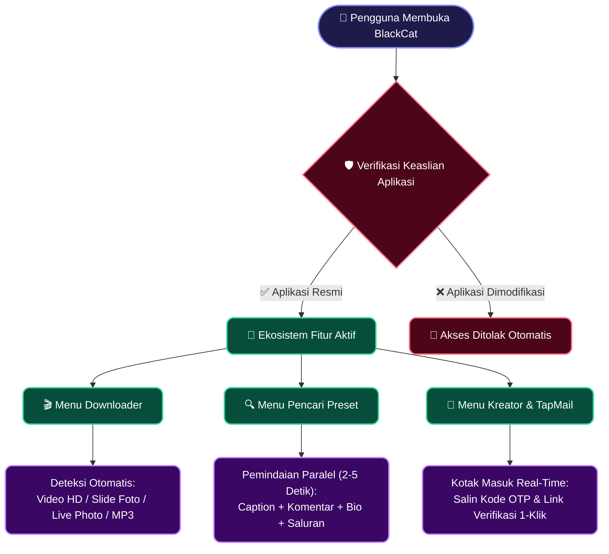
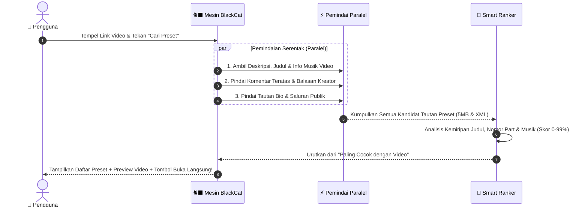

<!-- ========================================================================================= -->
<!--                    🐈‍⬛ BLACKCAT — ULTIMATE CREATOR & MEDIA SUITE                          -->
<!-- ========================================================================================= -->

<!-- ANIMATED WAVING HEADER -->

<!-- ANIMATED TYPING SVG -->

 

<!-- COLORFUL MODERN BADGES -->

  
  
  
  
  

  <a href="#-tampilan-visual--fitur-unggulan"><kbd>✨ Fitur Unggulan</kbd></a> •
  <a href="#-cara-kerja-aplikasi-alur-pintar"><kbd>⚙️ Cara Kerja</kbd></a> •
  <a href="#-detail-fitur-interaktif-klik-untuk-membuka"><kbd>🧩 Eksplorasi Fitur</kbd></a> •
  <a href="#-tabel-perbandingan-performa"><kbd>📊 Perbandingan</kbd></a> •
  <a href="#-panduan-penggunaan-cepat"><kbd>🚀 Cara Pakai</kbd></a>

<!-- ANIMATED RAINBOW DIVIDER -->

---

## 💬 Kutipan & Filosofi Desain

> *"Kecepatan tanpa mengorbankan estetika; menghadirkan pengalaman kreatif serba otomatis dalam satu sentuhan."*
> — **BlackCat Creator Suite**

> [!IMPORTANT]
> **BlackCat** adalah aplikasi *all-in-one* modern untuk para kreator konten dan editor video. Menggabungkan **Pengunduh Media TikTok Tanpa Watermark** (Video HD, Slide Foto, & *Live Photo*), **Pencari Preset Alight Motion Super Cepat**, **Tools Kreator Alight Motion**, serta **TapMail (Kotak Masuk Instan + Deteksi OTP Pintar)** dalam balutan desain **Material 3 Expressive & Liquid Glass**.

---

## 🎨 Tampilan Visual & Fitur Unggulan

<table>
  <tr>
    <td align="center" width="25%">
      
       
      <b>🎬 Multi-Format Downloader</b>
       
      Unduh Video HD Tanpa Watermark, Slide Foto Album, <b>Live Photo (Foto Bergerak)</b>, dan Audio MP3 jernih.
    </td>
    <td align="center" width="25%">
      
       
      <b>⚡ Turbo Preset Finder</b>
       
      Temukan tautan preset 5MB & XML dari video hanya dalam <b>2–5 detik</b> dengan teknologi pemindaian paralel.
    </td>
    <td align="center" width="25%">
      
       
      <b>📬 TapMail & Smart OTP</b>
       
      Email instan sekali klik dengan pemindai kode OTP 6-digit otomatis dan deteksi tautan verifikasi.
    </td>
    <td align="center" width="25%">
      
       
      <b>✨ Liquid Glass UI</b>
       
      Navigasi mengambang (<i>Floating Bar</i>) dengan animasi pegas halus, pemutar video internal, & tema adaptif.
    </td>
  </tr>
</table>

## ⚙️ Cara Kerja Aplikasi (Alur Pintar)

BlackCat dirancang agar pengguna tidak perlu lagi mencari tautan satu per satu atau berpindah-pindah aplikasi. Cukup tempelkan satu tautan, dan mesin pintar BlackCat akan bekerja secara otomatis di balik layar.

### 🗺️ Diagram Alur Ekosistem BlackCat (Interaktif)

> [!TIP]
> *Diagram di bawah ini bersifat **interaktif** di GitHub! Gunakan tombol panah & zoom di pojok kanan atas diagram untuk menjelajahi alur kerja aplikasi.*

---

### 🔄 Bagaimana Pencari Preset Bekerja dalam `2 – 5 Detik`?

Saat Anda menempelkan tautan video ke menu **Pencari Preset**, aplikasi menjalankan beberapa tugas sekaligus secara paralel (*simultaneous multi-tasking*):

## 🧩 Detail Fitur Interaktif (Klik untuk Membuka)

Klik pada masing-masing panel di bawah ini untuk melihat kecanggihan setiap menu di dalam **BlackCat**:

<b>🎬 1. Pengunduh Video, Slide Foto & Live Photo Tanpa Watermark</b>

 

- **Deteksi Format Pintar**:
  - **Video HD & Standar**: Unduh video TikTok dalam kualitas jernih tanpa tanda air (*No Watermark*) atau dengan watermark sesuai kebutuhan.
  - **Album Slide Foto**: Pilih foto tertentu yang ingin disimpan atau unduh seluruh slide sekaligus (*Batch Download*).
  - **Live Photo (Foto Bergerak)**: Mendukung pengunduhan konten *Motion Photo / Live Photo* baik dalam bentuk video bergerak maupun gambar.
  - **Ekstraksi Audio MP3**: Ambil musik atau *original sound* langsung menjadi berkas audio siap pakai untuk mengedit.
- **Pemutar Media Bawaan (*In-App Player*)**:
  - Putar pratinjau video, dengarkan musik, atau lihat galeri slide foto langsung dari dalam aplikasi sebelum maupun sesudah mengunduh.

<b>⚡ 2. Pencari Preset Alight Motion Pintar (5MB & XML)</b>

 

- **Pencarian Lintas Sumber Otomatis**:
  - Menemukan tautan preset yang diletakkan di **deskripsi video**, **komentar yang disematkan (*pinned*)**, **balasan komentar**, **komentar penonton**, hingga **tautan di profil/bio kreator**.
- **Deteksi Saluran WhatsApp & Telegram**:
  - Jika kreator menaruh preset di dalam saluran komunitas atau halaman tautan bio, BlackCat akan mendeteksinya secara otomatis dan menyediakan tombol pintas langsung.
- **Skor Kecocokan Cerdas (*Smart Match Badge*)**:
  - Setiap preset yang ditemukan diberi persentase kecocokan dan label **"Paling Cocok dengan Video"** agar Anda tidak salah memilih preset ketika terdapat banyak tautan.

<b>📬 3. TapMail Instan & Ekstraktor OTP Cerdas</b>

 

- **Email Instan Multi-Domain**:
  - Buat alamat email sementara secara instan hanya dalam satu ketukan, lengkap dengan opsi ganti domain kapan saja.
- **Pemindai OTP Pintar Anti-Salah**:
  - Menyaring isi pesan masuk secara cerdas untuk membedakan **Kode Verifikasi OTP 6-Digit** asli dari angka tahun, tanggal, atau jam di dalam email, lalu menampilkannya pada tombol salin cepat.
- **Deteksi Tautan Verifikasi Otomatis**:
  - Menemukan tautan aktivasi/verifikasi di dalam email HTML dan menyediakannya sebagai tombol aksi langsung.

<b>🛡️ 4. Sistem Proteksi Keaslian & Pembaruan Otomatis (Auto-Update)</b>

 

- **Proteksi Integritas Aplikasi**:
  - Dilengkapi sistem verifikasi berlapis berbasis *cloud* yang menjaga keaslian aplikasi. Apabila berkas APK dimodifikasi atau dibongkar secara ilegal, seluruh layanan akan otomatis terkunci demi keamanan ekosistem.
- **Notifikasi Update Otomatis di Dalam Aplikasi**:
  - Ketika versi terbaru dirilis, aplikasi akan menampilkan informasi pembaruan beserta catatan fitur baru (*changelog*) dan mengunduh pembaruan secara langsung di dalam aplikasi.

## 📊 Tabel Perbandingan Performa

| Fitur & Pengalaman Pengguna | Aplikasi Downloader Biasa | 🐈‍⬛ **BlackCat Suite** |
| :--- | :---: | :---: |
| **Unduh Video HD Tanpa Watermark** | ✅ Ya | ✅ **Super Cepat + Multi-Jalur** |
| **Dukungan Slide Foto & Live Photo (Foto Gerak)** | ❌ Terbatas | ✅ **Deteksi Otomatis & Batch Save** |
| **Pencari Preset Alight Motion (5MB & XML)** | ❌ Tidak Ada | ✅ **Otomatis dalam 2 – 5 Detik** |
| **Deteksi Saluran Kreator & Ranking Kecocokan** | ❌ Tidak Ada | ✅ **Smart Match Scoring** |
| **TapMail + Auto-Detect Kode OTP & Link** | ❌ Tidak Ada | ✅ **Terintegrasi Langsung** |
| **Desain Antarmuka Modern** | ⚠️ Standar / Kaku | ✨ **Material 3 + Liquid Glass UI** |
| **Pembaruan Aplikasi (*In-App Auto Update*)** | ❌ Manual | ✅ **Otomatis dengan Changelog** |

---

## 🛠️ Teknologi Antarmuka & Performa

| Komponen | Teknologi Modern |
| :--- | :--- |
| **Bahasa & Concurrency** |  `Kotlin Coroutines` & `StateFlow Reactive Engine` |
| **Desain UI & Animasi** |  `Material Design 3 Expressive` & `Liquid Glass Navigation` |
| **Pemutar Multimedia** |  `High-Performance In-App Video & Audio Player` |
| **Keamanan & Cloud** |  `Encrypted Edge Gateway & Integrity Verification` |

---

## 🚀 Panduan Penggunaan Cepat

> [!NOTE]
> Unduh dan pasang selalu versi resmi **BlackCat** melalui halaman [**Releases**](../../releases) agar seluruh fitur berjalan optimal dan mendapatkan pembaruan otomatis.

1. **Mengunduh Video / Slide / Live Photo TikTok**:
   - Salin tautan dari aplikasi TikTok ➔ Buka **BlackCat** ➔ Tautan akan terdeteksi atau tempelkan pada kolom input ➔ Pilih **Unduh Tanpa Watermark (HD)**, **Slide Foto**, atau **Audio MP3**.
2. **Mencari Preset Alight Motion dari Video**:
   - Buka menu **Preset** ➔ Tempelkan tautan video TikTok ➔ Tekan **Cari Preset** ➔ Dalam **2–5 detik**, daftar tautan preset **5MB** maupun **XML** yang paling cocok akan langsung muncul dan siap diimpor ke Alight Motion.
3. **Menggunakan TapMail & Kreator Tools**:
   - Buka menu **Alight Motion / TapMail** ➔ Buat email instan dengan satu klik ➔ Salin kode OTP 6-digit atau buka tautan verifikasi yang muncul secara otomatis.

---

<!-- ANIMATED WAVING FOOTER -->

